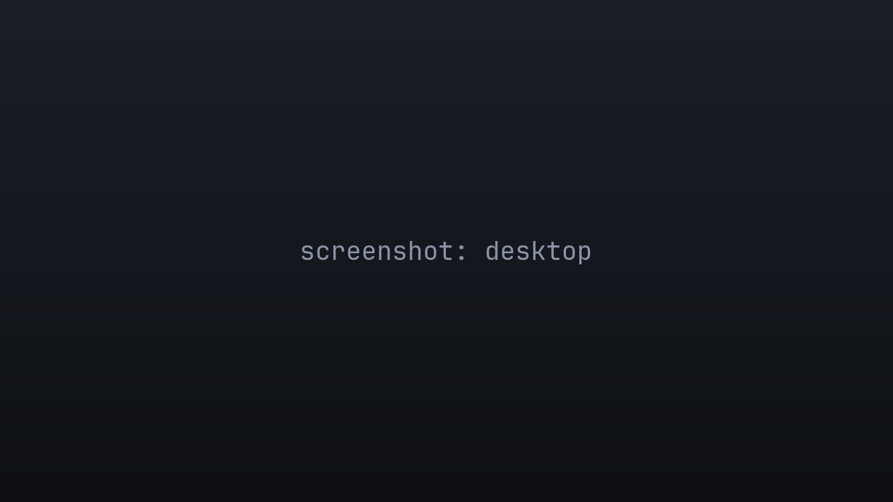
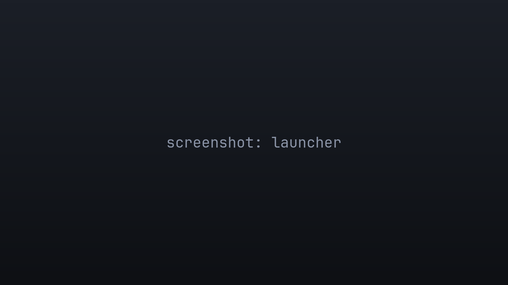
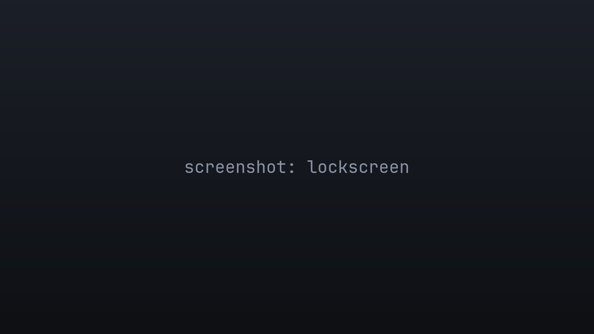

# arch-dotfiles

Мой рабочий стол на Arch Linux: Hyprland, панель на Quickshell, цвета из обоев через matugen. Ставится одной командой на чистую систему.



| Лаунчер | Экран блокировки |
|---|---|
|  |  |

*Скриншоты пока заглушки — заменю после первой установки на железе.*

## Что внутри

- **Hyprland 0.57** — оконный менеджер для Wayland. Конфиг на Lua, разбит на модули: `env`, `monitors`, `input`, `look`, `binds`, `rules`, `autostart`.
- **Quickshell** — панель сверху (воркспейсы, часы, раскладка, звук, сеть, трей), уведомления, плашка громкости и окно выбора обоев.
- **matugen** — берёт цвета с обоев и перекрашивает kitty, rofi, Quickshell, GTK, Qt, hyprlock, рамки окон, fish, Neovim и экран входа.
- **awww** (бывший swww) — обои с плавной сменой.
- **kitty + fish + starship**, лаунчер **rofi**, блокировка **hyprlock**, сон экрана **hypridle**.
- **SDDM** со своей темой `dots` — в тех же цветах, что и система.
- Шрифт JetBrainsMono Nerd Font, иконки Papirus, курсор Bibata.
- Для разработки: VS Code, Neovim (lazy.nvim, LSP, автодополнение), Docker, Node.js, Python, PostgreSQL, Java 8/11/17/21/27 (по умолчанию 21), Rust stable через rustup.
- Драйвер Nvidia `nvidia-open-dkms` с настройкой под Hyprland.

## Установка

**Первая команда в текстовой консоли (и на флешке, и после archinstall):**

```bash
setfont cyr-sun16
```

Без неё русские сообщения установщика (в том числе предупреждение о стирании диска) будут квадратиками. Шрифт `cyr-sun16` из пакета kbd (Arch Wiki: Linux console#Fonts). `install.sh` и сам ставит этот шрифт, если запущен в консоли, но первые строки лучше видеть сразу. Раскладку менять не нужно: где скрипт просит ввести «да», можно ввести `yes`.


### Вариант 1. Через archinstall (рекомендую)

1. Поставьте Arch через `archinstall`: файловая система btrfs, загрузчик systemd-boot, профиль «минимальный», обычный пользователь с sudo, сеть — NetworkManager.
2. Перезагрузитесь, войдите в консоль под своим пользователем и выполните:

```bash
sudo pacman -S --needed git
git clone https://github.com/KNate42/arch-dotfiles.git ~/arch-dotfiles
cd ~/arch-dotfiles
./install.sh
```

3. Перезагрузитесь, в SDDM выберите сессию Hyprland.

Скрипт по ходу задаст пару вопросов про Nvidia. На «убрать хук `kms`» отвечайте `yes`: так советует Arch Wiki для карт Nvidia. На «ранняя загрузка модулей» — «нет», если нужна гибернация, иначе можно `yes`.

### Вариант 2. Прямо с установочной флешки

Загрузитесь с образа Arch в режиме UEFI, подключите интернет (по кабелю — само, Wi-Fi — через `iwctl`) и выполните:

```bash
pacman -Sy git
git clone https://github.com/KNate42/arch-dotfiles.git
cd arch-dotfiles
./install.sh --from-iso
```

Скрипт покажет диски и попросит **дважды ввести имя диска** (например, `nvme0n1`). **Всё на этом диске будет стёрто.** Потом спросит имя компьютера, пользователя, часовой пояс и пароль, покажет будущую запись загрузчика (с параметром AppArmor) и попросит ввести «да» (или `yes`). Пароль root не задаётся: вход под root блокируется (`passwd -l root`), всё делается через sudo от вашего пользователя (Arch Wiki: sudo#Disable root login). Дальше сам:

- разметит диск: EFI 1 ГиБ + btrfs с подтомами `@`, `@home`, `@log`, `@pkg`, `@snapshots` (без шифрования — так решил владелец);
- поставит базовую систему, systemd-boot (сразу с параметром AppArmor), локали en_US и ru_RU;
- запустит обычную установку уже внутри новой системы.

Если установка оборвётся, снова запустите `./install.sh --from-iso` с той же флешки. Скрипт найдёт недоделанную систему: раздел btrfs с меткой `arch`, раздел EFI на том же диске и файл стадии. Ищет он, монтируя только на чтение. Потом покажет диск и попросит ввести его имя. После этого смонтирует всё как надо и продолжит с того места, где остановился, — **без разметки и форматирования**. Если сбой случился раньше, чем диск был размечен и смонтирован, продолжать нечего, и скрипт начнёт с выбора диска.

Если система уже загружается, но dotfiles встали не до конца, войдите в консоль и запустите `cd ~/arch-dotfiles && ./install.sh` — готовое он пропустит.

### Полезные флаги

```bash
./install.sh --dry-run        # показать, что будет сделано, ничего не трогая
./install.sh --only 55,60     # запустить только нужные шаги
./install.sh --bootloader     # дополнительно предложить nvidia_drm.modeset=1 в параметры ядра
./install.sh --apparmor-d     # дополнительно набор профилей apparmor.d из AUR (спросит «да»)
./install.sh --secure-boot    # свои ключи Secure Boot через sbctl (спросит «да»)
./install.sh --trust-aur      # ставить пакеты из AUR, не показывая PKGBUILD
bash install.d/30-nvidia.sh   # любой шаг можно запустить отдельно
```

Повторный запуск безопасен: уже сделанное он пропускает и ничего не ломает.

## Что делает install.sh

Каждый шаг — отдельный файл в `install.d/`, у шагов есть зависимости. Если шаг упал, всё, что от него зависит, не запускается. Например, при ошибке драйвера Nvidia, AppArmor, настроек безопасности или темы не включится экран входа SDDM (`80-services`), и вы не окажетесь перед сломанным графическим входом. Независимые шаги выполняются. В конце будет список упавших и пропущенных. Если упал `00-preflight`, установка останавливается сразу. Если бэкап или `55-stow` сорвались посередине, унесённые конфиги возвращаются на место по журналу — и при первой, и при повторной установке.

| Шаг | Что делает |
|---|---|
| `00-preflight` | проверяет, что это Arch, есть sudo и интернет; включает multilib |
| `10-base` | ставит пакеты из `packages/pacman.txt` |
| `15-yay` | ставит yay, если его нет |
| `20-aur` | ставит пакеты из `packages/aur.txt` |
| `30-nvidia` | драйвер, заголовки для всех ядер, initramfs, проверка сборки DKMS |
| `35-bootloader` | по умолчанию пропускается, см. ниже |
| `36-secureboot` | только с `--secure-boot`, см. «Безопасность» |
| `38-apparmor` | AppArmor: пакет, служба, параметр ядра (правка загрузчика — после «да») |
| `40-dev` | Docker, PostgreSQL, Rust stable, Java 21 по умолчанию, npm без sudo |
| `45-security` | файрвол, DNS-over-TLS, случайный MAC, таймаут sudo, без дампов памяти, сканеры |
| `50-backup` | убирает старые конфиги, которые мешают, в `~/.config-backup-<дата>` |
| `55-stow` | раскладывает конфиги ссылками через GNU Stow |
| `60-theme` | обои в `~/Pictures/wallpapers`, настройки Qt, первая палитра |
| `70-sddm` | тема экрана входа |
| `80-services` | NetworkManager, bluetooth, SDDM |

**Про загрузчик.** Для Hyprland на Nvidia раньше нужно было дописывать `nvidia_drm.modeset=1` в параметры ядра. Сейчас пакет `nvidia-utils` включает это сам, поэтому скрипт загрузчик не трогает. Если хотите прописать параметр явно, запустите `./install.sh --bootloader`: скрипт найдёт ваш загрузчик (systemd-boot, Limine или GRUB), покажет правку и применит её, только если вы введёте «да». Рядом останется копия `.bak`.

## Безопасность и приватность

### Файрвол
Стоит **nftables**: его рекомендует Arch Wiki, на нём же работают iptables-nft и Docker. ufw — надстройка над iptables, и опубликованные порты Docker известным образом обходят его правила. Правила лежат в `/etc/nftables.conf`. Входящие соединения запрещены, кроме ответов на ваши запросы, loopback и ICMP. Исходящие разрешены.

**Docker.** Docker сам добавляет правила для контейнеров, и они обходят входящий фильтр. Поэтому в `/etc/docker/daemon.json` прописано `"ip": "127.0.0.1"`: `docker run -p 8080:80` открывает порт только для этого компьютера. Чтобы открыть порт в сеть, это надо написать явно: `-p 0.0.0.0:8080:80`. Мой `/etc/nftables.conf` не делает `flush ruleset`, поэтому перезапуск файрвола не ломает сеть контейнеров.

**Группа docker — это права root.** Кто в группе docker, тот может стать root без пароля. Если это не устраивает, Docker можно запускать без root (rootless): Arch Wiki, «Docker#Rootless Docker daemon». По умолчанию оставлен обычный режим.

### DNS и сеть
- DNS-запросы идут через systemd-resolved по **DNS-over-TLS** на Quad9, с `DNSSEC=allow-downgrade`. Провайдер не видит, какие сайты вы открываете. Сменить сервер — одна строка `dns_servers` в `install.d/45-security.sh`, после неё запустите `bash install.d/45-security.sh && sudo systemctl restart systemd-resolved`.
- Режим строгий: если TLS не получился, запрос не уходит открытым текстом. DNS от роутера не используется (`dns=none` в NetworkManager). Минус: в кафе и отелях страница входа в Wi-Fi может не открыться. Тогда временно выключите DNS-over-TLS (`sudo rm /etc/systemd/resolved.conf.d/20-dns-over-tls.conf && sudo systemctl restart systemd-resolved`), а потом верните его запуском шага 45.
- Wi-Fi: пока идёт поиск сетей, MAC-адрес случайный. При подключении у каждой сети свой постоянный адрес (`stable`). Отследить вас по MAC между сетями нельзя, а домашний роутер видит одно и то же устройство.

### Телеметрия
- **VS Code**: в `settings.json` выключены телеметрия (`telemetry.telemetryLevel: off` отключает и отчёты о сбоях), эксперименты, онлайн-рекомендации расширений и онлайн-поиск в настройках. Расширения могут отправлять свои данные независимо от этой настройки — смотрите описание каждого.
- `settings.json` — ссылка в репозиторий. Настройки, которые вы меняете в VS Code, попадут в репо. Это удобно, но перед коммитом смотрите diff.
- **pkgstats** (отправляет список пакетов) не ставится. Если он уже есть, установщик предупредит.
- Hyprland: выключены всплывающие новости обновлений и просьбы о донатах.
- Остальной стек (kitty, fish, starship, Neovim, Quickshell, rofi, Docker CLI, Node.js, Python, Rust, Java) сам ничего не отправляет. .NET, Next.js и подобные не ставятся, поэтому переменных для отключения их телеметрии нет.

### AUR
В AUR пакет может выложить кто угодно; в 2025 году там находили вредоносные пакеты. Поэтому:
- из AUR ставится минимум: `yay-bin`, `bibata-cursor-theme-bin`, `visual-studio-code-bin`. Тема SDDM своя, из репо;
- перед сборкой установщик показывает PKGBUILD каждого пакета и спрашивает, собирать ли. Смотрите, откуда скачиваются файлы (`source=`), что делают `build()` и `package()`, нет ли там `curl ... | sh`;
- флаг `--trust-aur` отключает показ. Так быстрее и без вопросов, но AUR вы доверяете вслепую;
- yay настроен показывать диффы PKGBUILD при каждом обновлении (`yay --save --diffmenu --answerdiff All`).

### Сканеры: только вручную, без фоновой нагрузки
Поставлены clamav, rkhunter и lynis, их службы не включены. Только базы clamav раз в сутки обновляет таймер `clamav-freshclam-once.timer`.

```bash
sudo freshclam                          # обновить базы clamav прямо сейчас
clamscan -r --infected ~/Downloads      # проверить папку на вирусы
sudo rkhunter --propupd                 # один раз после установки: запомнить «чистое» состояние
sudo rkhunter --check --sk              # искать руткиты
sudo lynis audit system                 # аудит настроек безопасности с советами
```

### Прочее
- sudo снова спрашивает пароль через 5 минут бездействия (`/etc/sudoers.d/30-timeout`).
- Дампы памяти упавших программ не сохраняются (`/etc/systemd/coredump.conf.d/20-disable.conf`): в них бывают пароли.
- **AppArmor** включается при обычной установке (шаг `38-apparmor`): пакет `apparmor`, служба `apparmor.service` и параметр ядра `lsm=landlock,lockdown,yama,integrity,apparmor,bpf` (строка из Arch Wiki). Правку загрузчика скрипт показывает как diff и применяет только после ввода «да», рядом остаётся копия `.bak`. При установке с флешки параметр сразу пишется в запись systemd-boot. Работают штатные профили из пакета. После первой загрузки проверьте: `aa-enabled` (должно быть `Yes`) и `sudo aa-status`.
- **apparmor.d** — большой набор готовых профилей (AUR, проект roddhjav). По Arch Wiki он пока не считается стабильным, поэтому ставится только флагом `--apparmor-d`, после просмотра PKGBUILD и ввода «да». Риск: какие-то программы перестанут работать, пока их профиль не поправят. Профили Hyprland, kitty, Quickshell, rofi, hyprlock и других программ рабочего стола скрипт переводит в режим complain: нарушения только пишутся в журнал. Если программа сломалась: `sudo aa-complain /etc/apparmor.d/<программа>`.
- **Secure Boot** со своими ключами — `./install.sh --secure-boot`. Сначала переведите Secure Boot в BIOS в Setup Mode (сброс ключей). Скрипт через sbctl:
  - создаст ключи;
  - после отдельного «да» запишет их в прошивку вместе с ключами Microsoft (без них может не запуститься прошивка видеокарты) и проверит, что прошивка вышла из Setup Mode;
  - подпишет systemd-boot, все ядра `vmlinuz-*` и UKI, если они есть. При обновлениях их переподписывает хук sbctl;
  - прогонит `sbctl verify` и только если неподписанных файлов нет, скажет, что можно включать.

  Потом включите Secure Boot в BIOS. **Риск:** на некоторых прошивках компьютер после этого не загрузится. **Откат:** выключить Secure Boot в BIOS — система загрузится как раньше. Модули Nvidia из DKMS не подписываются: штатное ядро Arch их подписи не требует, но после включения это обязательно надо проверить.

## Горячие клавиши

`Super` — клавиша Windows.

| Клавиши | Действие |
|---|---|
| `Super + Enter` | терминал |
| `Super + Q` | закрыть окно |
| `Super + D` | лаунчер приложений |
| `Super + 1…9` | перейти на рабочий стол |
| `Super + Shift + 1…9` | перенести окно на рабочий стол |
| `Super + H / J / K / L` | фокус влево / вниз / вверх / вправо |
| `Super + Shift + H / J / K / L` | сдвинуть окно |
| `Super + F` | на весь экран |
| `Super + Shift + F` | развернуть (с панелью) |
| `Super + Space` | сделать окно плавающим и обратно |
| `Super + Escape` | заблокировать экран |
| `Super + W` | сменить обои — вся система перекрасится |
| `Super + A` | центр управления: Wi-Fi, «Не беспокоить», звук, плеер, календарь, трей |
| `Super + V` | история буфера обмена |
| `Print` | скриншот области: файл в `~/Pictures/Screenshots` и в буфер |
| `Alt + Shift` | переключить раскладку us/ru |
| `Super + Shift + E` | меню питания: блокировка, выход, перезагрузка, выключение |
| `Super + Ctrl + Shift + E` | выйти из Hyprland сразу, без меню |
| `Super + колесо мыши` | листать рабочие столы |
| `Super + ЛКМ / ПКМ` | двигать / растягивать окно |

## Обои и цвета

`Super + W` открывает сетку обоев из `~/Pictures/wallpapers`. Выбрали картинку — и:

1. awww плавно меняет обои;
2. matugen строит палитру из картинки;
3. kitty, Quickshell и рамки окон перекрашиваются сразу, rofi — при следующем открытии, GTK и Qt-программы — после перезапуска;
4. картинка и цвета копируются для экрана блокировки и экрана входа.

Своих обоев просто добавьте в `~/Pictures/wallpapers`. Из терминала: `wallpaper-set путь/к/картинке.jpg` или `wallpaper-set --random`.

Обои в `wallpapers/` нарисованы для этого репозитория, их можно использовать как угодно.

## Телевизор

Телевизор Samsung при подключении встаёт справа от основного монитора, рабочие столы 6–9 переезжают на него, а звук переключается на HDMI. При отключении звук возвращается обратно.

Если ваш телевизор не опознаётся, посмотрите его описание командой `hyprctl monitors all` (строка `description`) и поправьте `tv_desc` в `hypr/.config/hypr/modules/monitors.lua`.

## Как всё устроено

```
install.sh, install.d/   установка, по шагу на файл
lib/ui.sh                общие функции вывода, без состояния
lib/bootloader.sh        правка параметров ядра (diff, .bak, «да»)
packages/                списки пакетов pacman, AUR и пакетов stow
hypr/ quickshell/ kitty/ fish/ starship/ rofi/ matugen/ gtk/ nvim/ scripts/ vscode/
                         пакеты GNU Stow: внутри та же структура, что в домашней папке
sddm-theme/              тема экрана входа
wallpapers/              обои
tests/                   проверка всей установки в Docker-контейнере Arch
```

Конфиги раскладываются ссылками с `stow --no-folding`: ссылками становятся только файлы, а папки остаются настоящими. Поэтому файлы цветов, которые пишет matugen, живут в системе и не попадают в репозиторий.

## Откат

- Старые конфиги лежат в `~/.config-backup-<дата>` с теми же путями — верните нужное обратно.
- Убрать ссылки на конфиги: `cd ~/arch-dotfiles && stow -D --dir . --target ~ $(grep -v '^#' packages/stow.txt)`.
- Правки загрузчика (если делали) — рядом с файлом лежит копия `.bak-<дата>`.

## Если что-то пошло не так

Подробная офлайн-памятка на случай проблем с загрузкой, чёрного экрана SDDM/Hyprland, отсутствия DNS или прерванной установки: [docs/RECOVERY.md](docs/RECOVERY.md) (из консоли: `less ~/arch-dotfiles/docs/RECOVERY.md`).

Быстрый помощник из терминала или `tty`:

```bash
dots-recover info     # сводка: dkms, nvidia-smi, упавшие службы, AppArmor, DNS
dots-recover nosddm   # отключить SDDM и запускать Hyprland вручную
dots-recover dns      # вернуть обычный DNS через NetworkManager без DoT
```

## Проверка

```bash
bash tests/run.sh
```

Скрипт поднимает чистый контейнер `archlinux:latest` и проверяет там: shellcheck, правки initramfs и загрузчиков на образцах, с подменёнными системными командами — обработку ошибок и возобновление установки с флешки, откат бэкапа и stow, защиту цветов от сбоя matugen, выбор звукового выхода ТВ; имена всех пакетов, что `--dry-run` ничего не меняет (и на чистой, и на уже настроенной системе; созданные, изменённые и удалённые файлы), установку целиком, бэкап (в том числе папки-ссылки на чужой репо), что повторный запуск ничего не меняет, конфиг Hyprland (`Hyprland --verify-config`), палитру matugen и смену обоев, правила nftables, файлы настроек безопасности.

Что в контейнере проверить нельзя и нужно посмотреть на живом железе: установка с флешки, запуск Hyprland на Nvidia, сон и пробуждение, экран входа SDDM, подключение телевизора и звук по HDMI, DNS-over-TLS (`resolvectl status`), AppArmor и Secure Boot.
